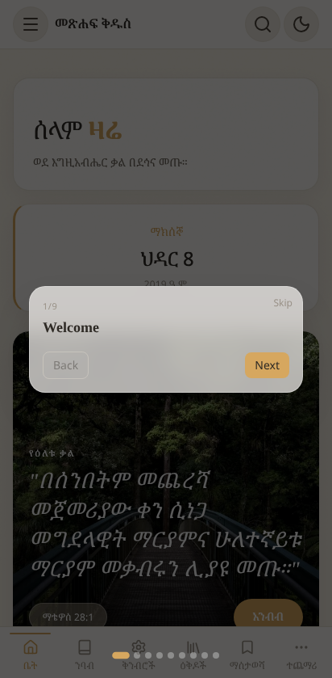
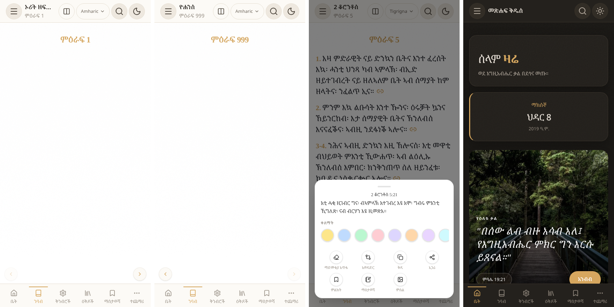
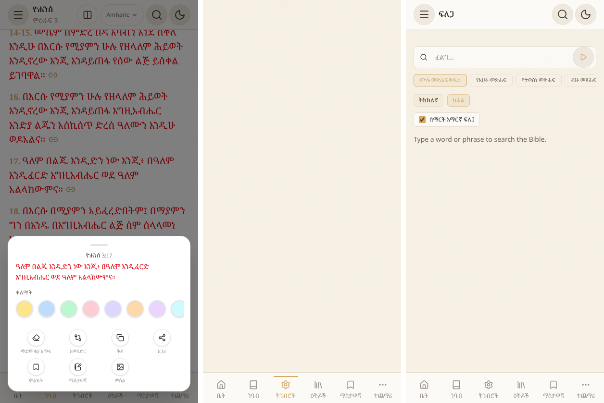

# 01 — Analysis and testing of the old app (APK v1.0.4)

## How it was tested

- Unpacked `app-debug.apk` and read the manifest, native Java code (decompiled) and the web bundle (1.18 MB of minified JavaScript, reformatted for reading).
- Decompressed the 5 bundled Bible databases and checked every book, chapter and verse against KJV numbering.
- Served the web app as the Android WebView would and drove it with Playwright on a Pixel 7–sized screen: about 30 automated checks, plus performance runs with the CPU slowed 4× to mimic a budget phone.
- Not tested: the native widget, notifications, sharing and image saving, and appearance on a real phone. (No Android emulator was available.)

## How the app is built

| Part | Details |
|---|---|
| Wrapper | Capacitor; one `MainActivity`, minSdk 24, targetSdk 36 |
| UI | React + React Router, built with Vite, Tailwind CSS |
| Bible data | 5 SQLite databases compressed with zstd (Amharic, KJV, NASV, Tigrigna, Oromo), opened with sql.js (SQLite in WebAssembly), up to 3 open at once |
| Extra Bibles | 12 more downloadable from a public file host (Wolaytta, Gamo, Somali, WEB…) |
| Other data | Cross-references, Strong's lexicon, 1,139 daily verses, reading plans |
| Native code | Home-screen daily-verse widget, boot receiver, small plugin to update the widget |
| Settings and user data | Browser `localStorage` (`ethiobible_state_v1`) |

## What's good

- **Complete offline Bibles:** all 5 have 66 books and 1,189 chapters, with no empty or duplicate verses.
- **Fast:** home screen in ~2.3 s and a chapter in 120–220 ms even with the CPU slowed 4×; ~60 MB memory.
- **Correct Ethiopian calendar:** checked on 9 dates, including leap years and Pagume.
- **No obvious security holes:** no raw HTML from user input (notes are stored as plain text), deep-link parameters parsed safely, no trackers, immutable PendingIntents.
- **Saving works:** highlights, bookmarks and notes survive restarts; full storage doesn't crash the app.
- **Translations:** English, Amharic and Oromo each have all 697 interface strings.

## Serious bugs

### 1. Widget link opens the wrong chapter on a cold start
If the app isn't running, a link such as `ethiobible://read?book=43&chapter=3&verse=16` opens the last-read chapter instead. Reproduced 3/3 times; a highlight made afterwards was saved on Genesis 1:16 instead of John 3:16.

**Cause:** the settings provider restores the saved book and chapter in an effect that runs *after* the reader applied the URL, overwriting it.
**Fix:** apply link parameters only after saved settings have loaded.

### 2. Tigrigna: 85 verses merged into the previous verse in 74 chapters
For example 2 Corinthians 5:21, 1 Corinthians 1:31, 2 Chronicles 35:27, Psalm 149:7–9. These verses can't be opened, highlighted or bookmarked. Opening 2 Corinthians 5:21 showed a sheet labelled "2 Corinthians 5:21" containing **John 3:21's text**, left over from the previous chapter.

## Medium

3. **6 daily verses don't exist in any Bible.** They use Hebrew numbering: Psalm 31:25, 44:27, 60:14, Isaiah 8:23, Malachi 3:20, 3:23. The app silently showed verse 1 instead, so Psalm 60:14 ("Through God we shall do valiantly") became Psalm 60:1, a lament. Correct: Psalm 31:24, 44:26, 60:12, Isaiah 9:1, Malachi 4:2, 4:5.
4. **Links to verses after 120 stay at the top.** The reader draws 120 verses at a time and can't scroll to Psalm 119:121–176. Four daily verses are affected (119:126, 133, 147, 172).
5. **Daily verse is random per phone and changes at 3 AM in Ethiopia.** It's chosen with a random number and keyed by the UTC date.
6. **Invalid links show a blank page** (e.g. `book=99`, `chapter=999`), with no message.
7. **Wasted work at launch:** 6 requests for files that don't exist (`db_modules/*.db.zst` and `.gz`) on every launch; on first launch, all 5 Bibles are decompressed and the result discarded.
8. **Debug build settings:** debuggable, debug-signed, backups allowed. Expected for `app-debug.apk`; check the release build.

## Polish

- Version shown as **1.0.0** on the "More" page (hard-coded); the APK is 1.0.4.
- Onboarding tour is English-only with empty descriptions; the search hint is English in the Amharic UI; 11 Oromo strings still English.
- Accessibility: 19 buttons in the verse menu (12 colours, 7 actions) have no screen-reader labels; 54 reader controls are smaller than 44 px.
- 5.5 MB of duplicate files (fonts twice, some images twice). The Nokia Pure Headline font is proprietary — check its licence. Google Fonts are downloaded although fonts are bundled.
- Four widget background names (highlight, homescreen, reading_plans, setting_tools) show photos; their own backgrounds are never used.
- Downloaded Bibles aren't checked with a checksum; file sharing exposes the whole external storage root.
- `/settings` page is blank (only reachable by URL).

## Corrections made during testing

- Psalm 119 *does* show all 176 verses when you scroll; only jumping to a verse past 120 fails (bug 4).
- Romans 8:28's verse sheet is correct; the wrong-text sheet happens only when the requested verse doesn't exist (bug 2).
- Deep links work when the app is already running; only cold starts are affected (bug 1).
