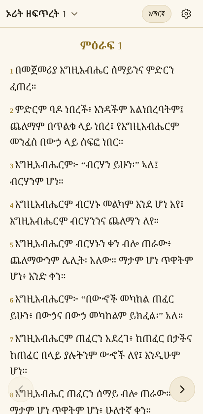
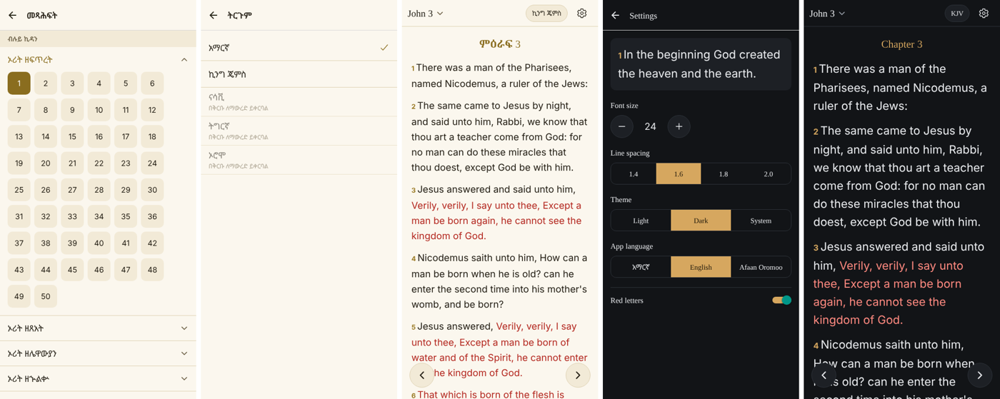

# 06 — Phase 2: the reader

Repository `holy-bible-et`, three commits (dated 12, 15 and 18 Dec 2025).

## What's built

| Part | Details |
|---|---|
| Reader | Chapter text, chapter heading, previous/next buttons that cross into the next or previous book and stop at Genesis 1 and Revelation 22 |
| Book picker | Old and New Testament, tap a book for its chapters; opens scrolled to the book you're reading |
| Translations | Amharic and KJV selectable; NASV, Tigrigna, Oromo shown as "download coming soon" (phase 7) |
| Settings | Font size (14–32), line spacing, light/dark/system theme, interface language (Amharic, English, Oromo), red letters on/off, live Genesis 1:1 preview |
| Saved settings | Stored on the phone; corrupted values fall back to defaults; the app waits until they've loaded before showing anything — the design that prevents the old app's deep-link bug |
| Fonts | Noto Serif/Sans Ethiopic (SIL Open Font License); Latin text uses the system font |
| Colours | Light ("classic paper") and dark ("deep night"); all text meets WCAG AA contrast (verse numbers were darkened to pass) |
| Accessibility | Every button has a screen-reader label in the chosen language; tap targets at least 44 px |
| Browser | `npx expo start --web` works (`metro.config.js` adds what SQLite needs) |

## Checks

| Check | Result |
|---|---|
| Unit tests | 60 passed (navigation, settings store incl. corrupted data, verse rendering, wording in all 3 languages, plus phase 1) |
| Each commit on its own | Typechecks and passes tests |
| TypeScript, ESLint, data validation | Pass |
| Browser test on a Pixel 7–sized screen | Next/previous, picker → John 3, picker opens at Revelation, switch to KJV, red letters, font size and dark theme survive a reload, Revelation 22 "next" disabled, Psalm 119 scrolls to verse 176, no errors |
| On a real phone | Not yet |

## Next: phase 3 (deep links)

`ethiobible://read?book=43&chapter=3&verse=16` opens the right chapter and scrolls to the verse — on a cold start, and for verses past 120.
