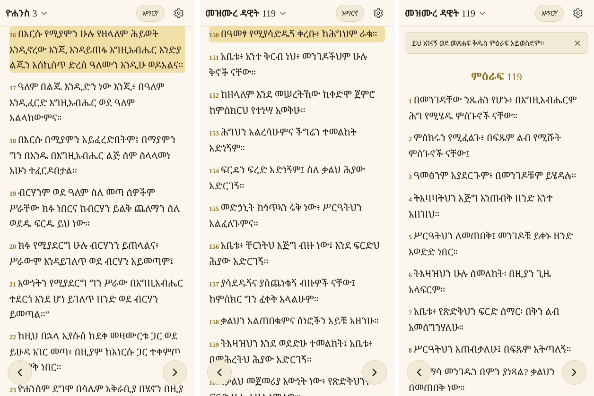

# 07 — Phase 3: links that open a verse

Repository `holy-bible-et`, two commits (dated 21 and 24 Dec 2025).

## What's built

| Link | Result |
|---|---|
| `ethiobible://read?book=43&chapter=3&verse=16` | Opens John 3, scrolls to verse 16, highlights it for 3 seconds |
| Same link when the app wasn't running | Same — the saved position no longer overwrites it (the old app's serious bug #1) |
| `book=19&chapter=119&verse=150` | Reaches Psalm 119:150 (verses past 120 were unreachable in the old app) |
| `book=JHN`, `book=1`, `verse=16-18` | Book codes, unpadded numbers and verse ranges accepted |
| Old widget format with `glowOnly=1` | Works |
| `book=99`, `chapter=999` | Stays on the current chapter and shows "This link doesn't point to a Bible chapter" (dismissible) |
| `verse=99` | Opens the chapter and shows "No matching verse" — never another verse's text |

## How the cold-start bug is prevented

The app shows nothing until saved settings have loaded; the link is applied after that, then cleared so it isn't applied twice.

`__tests__/deep-link.test.tsx` opens the real app screens from a link while settings are still loading. To prove it guards the bug, the protection was removed on purpose: 4 of the 5 link tests failed; with it restored, all pass.

## Checks

| Check | Result |
|---|---|
| Unit and screen tests | 80 passed (link parsing, cold-start link, invalid link, missing verse, plus earlier phases); each commit passes on its own |
| TypeScript, ESLint, data validation | Pass |
| Browser, phone size | 11/11: cold-start link 3 of 3 times (the old app failed 3 of 3), Psalm 119:150 on screen and highlighted, highlight fades, invalid link message and dismiss, missing verse, same-chapter link, old widget format; no errors |

## Needs checking

- New wording "This link doesn't point to a Bible chapter" in Amharic and Oromo was written for this phase; a native speaker should check it.
- Not yet tried on a real phone. To test a link there: `npx uri-scheme open "ethiobible://read?book=43&chapter=3&verse=16" --android` (or `--ios`) with the app running in a development build.

## Next: phase 4 (user data)

Highlights, notes, bookmarks and reading history, plus backup export/import compatible with the old app's backup file.
