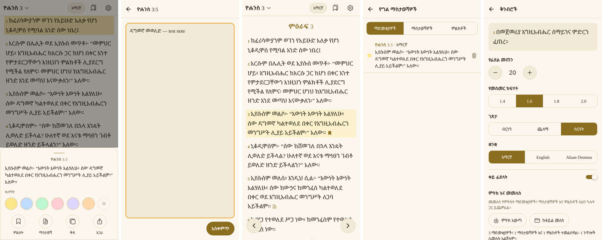

# 08 — Phase 4: your highlights, notes, bookmarks and backups

Repository `holy-bible-et`, three commits (dated 27 Dec 2025, 30 Dec 2025, 2 Jan 2026).

## What's built

| Feature | Details |
|---|---|
| Verse menu | Tap a verse: 6 highlight colours (the original app's first six), clear, bookmark / remove bookmark, note, copy, share |
| Accessibility | Every control in the menu has a spoken label in Amharic, English and Oromo (the original menu had 19 unlabelled buttons) |
| In the reader | Highlight colour behind the verse, bookmark and note icons after it |
| My notes | Highlights (with verse text), Notes, Bookmarks; tap to open in the reader, delete per item |
| Notes | Editor with save and delete (with confirmation) |
| Reading history | Every chapter opened is recorded (re-opening within 10 minutes isn't); used by the home screen in phase 5 |
| Backup | Settings → Export backup (share sheet; download in a browser) |
| Restore | Accepts this app's backups and the original app's; adds to existing data; importing the same file twice adds nothing; reports how many items were restored and skipped |
| Storage | Separate `user.db` with versioned migrations; changes are saved before they're shown |

## Moving from the original app

The original app's backup (`holy-bible-backup-YYYY-MM-DD.json`, from its Backup menu) restores highlights, bookmarks and notes, including older highlight keys that had no translation. Highlights on part of a verse can't be imported and are counted as skipped.

## Checks

| Check | Result |
|---|---|
| Tests | 98 passed; each of the 3 commits passes on its own |
| New tests | Database (highlights per translation, bookmarks, notes, history dedupe), backup round-trip, original-app backup, bad files rejected, bad items skipped, menu labels, colour toggle |
| Browser, phone size | Highlight, bookmark, copy (verse + reference on the clipboard), note, all survive reload; My notes tabs; open from list; export file contents; restore of an original-app backup (3 highlights, 1 note, 1 bookmark, 1 skipped); delete; no errors |
| On a real phone | Not yet |

## Needs checking by a native speaker

New wording written for this phase (not from the original app):
- Amharic: ምልክቶች, እስካሁን ምልክት የለም።, ምልክት አንሳ, ተቀድቷል, colour names (ቢጫ, ሰማያዊ, አረንጓዴ, ሮዝ, ወይን ጠጅ, ብርቱካናማ), ይህ ማስታወሻ ይሰረዝ?, the restore summary and "items couldn't be restored", the merge note.
- Oromo: the same messages, especially the colour names (Keelloo, Cuquliisa, Magariisa, Diimaa laafaa, Hurrii, Burtukaanii), which I'm least sure of.

## Next: phase 5 (home and daily verse)

Home screen with the Ethiopian date, a verse of the day that's the same for everyone and changes at local midnight, "continue reading", and daily notifications.
