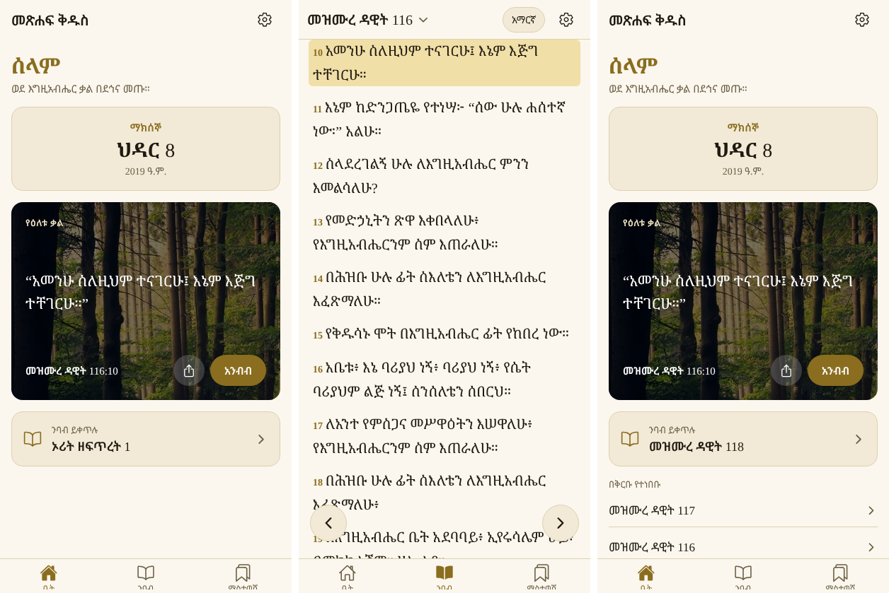

# 09 — Phase 5: home, verse of the day and reminders

Repository `holy-bible-et`, three commits (dated 5, 8 and 11 Jan 2026).

## What's built

| Feature | Details |
|---|---|
| Tabs | Home, Read, My notes |
| Ethiopian date | Weekday, month and day, year (e.g. ማክሰኞ · ህዳር 8 · 2019 ዓ.ም.) in Amharic, English or Oromo; checked on 9 known dates incl. leap years and Pagume |
| Verse of the day | On one of the original app's 10 photos, with Read (opens and highlights the verse) and Share |
| Fair and predictable | Same verse on every phone for the same local date; changes at local midnight; a fixed shuffle so it goes through all 1,137 verses before repeating and rarely repeats a book on consecutive days |
| Continue reading | Your last chapter |
| Recently read | Up to 5 chapters from reading history |
| Daily reminder | Settings (phone only): off by default; asks for permission; schedules the next 7 days at the chosen time (06:00–21:00), each with that day's verse; refreshed whenever the app opens; tapping opens the verse |

Old-app bugs fixed here: the random per-phone verse that changed at 03:00 in Ethiopia (bug #5).

## Found and fixed during this phase

- **Duplicate daily verses:** after phase 1's Hebrew-numbering fixes, Psalm 31:24 and 60:12 appeared twice (the corrected verses were already in the list). The data build now removes duplicates and validation rejects them; the list is 1,137 verses. A test ("goes through every verse before repeating") caught it.
- **Blank page in a browser:** the notification-tap code isn't available on the web and blanked the whole app there. It now does nothing on the web. Phones were not affected.

## Checks

| Check | Result |
|---|---|
| Tests | 119 passed; each commit passes on its own |
| Cold-start link protection | Still guarded after moving to tabs (removing it fails 4 of 5 link tests) |
| Browser, Addis Ababa time zone | Date ማክሰኞ ህዳር 8 2019 ዓ.ም. on 17 Nov; 23:59 Psalm 116:10 → 00:01 Isaiah 55:6 and ረቡዕ ህዳር 9; still Isaiah 55:6 at 03:01; changes at midnight while the app stays open; Read opens and highlights the verse; continue and recently read update; reminder setting hidden in the browser; no errors |
| Reminders on a real phone | Not yet tested — needs a phone. In Expo Go they may need a development build. |

## Needs checking by a native speaker

New wording: "Recently read", "Daily verse reminder", "Time", and the notifications-turned-off message (Amharic and Oromo). Oromo weekday names, and the Oromo year suffix (left blank; Amharic uses ዓ.ም., English E.C.).

## Next: phase 6 (search and reading plans)
