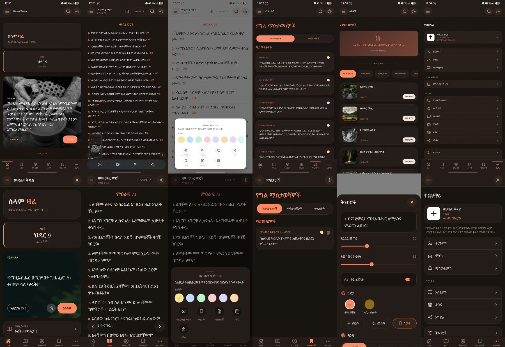

# 10 — Restyle to match the original app

Repository `holy-bible-et`, three commits (dated 14, 17 and 20 Jan 2026).

The 13 phone screenshots of the old app were used as the design reference. The new app now uses the same warm coral-on-brown look and the same layout. All the fixes from earlier phases are kept.

## What changed

| Screen | Now |
|---|---|
| Colours | "Sunset Warm" (the old app's look) is the default, in dark and light. The earlier paper look is kept as "Classic". Every text and background pair passes accessibility contrast; white on coral (2.4:1) was replaced with dark text on coral. |
| Header | Round menu button, title with the chapter below it, translation pill, light/dark switch |
| Books | Side drawer: Old/New Testament pills, books on the left, chapters in a column on the right, opened at the current book and chapter |
| Translations | Dropdown under the header with a tick on the current one; translations not in the app yet are greyed out |
| Settings | Bottom sheet: preview verse, sliders for text size and line spacing, red letters, palette, light/dark/system, language, reminder, backup |
| Bottom bar | Home, Read, Settings (opens the sheet), Notes, More |
| More | About card, translations, backup, notifications, feedback and support (the old app's Telegram bot), share, settings |
| Home | "ሰላም ዛሬ" greeting card, date card with a coral edge, verse reference in a pill |
| Notes | Large title, pill tabs (highlights, notes, bookmarks), one card per verse with its colour dot, empty-state icon |
| Verse menu | Floating card with colour circles and a grid of outlined round actions. "Clear highlight" is an action, enabled only when the verse is highlighted. |

## Not copied (yet)

- **Plans tab, search button:** added in phase 6.
- **Image and compare actions in the verse menu:** phase 7.
- **The old app's "+" button on Notes:** notes are still started from a verse.
- **Font picker:** the app uses its bundled Ethiopic fonts.

## Checks

| Check | Result |
|---|---|
| Tests | 123 passed (new: slider rounding, default palette, clear-highlight action); each commit passes on its own |
| Typecheck, lint | Clean |
| Browser (Pixel 7 size, dark mode) | Home, reader header, translation dropdown, verse menu (pick a colour, clear enabled), books drawer → John 3, settings sliders, notes card for the highlighted verse, More page; no errors |

## Needs checking by a native speaker

New wording: "ማውጫ" (index), "ምዕ." (chapter), palette names "ሙቅ ምሽት" and "ክላሲክ ወረቀት", and the Oromo versions.

## Next: phase 6 (search and reading plans)
