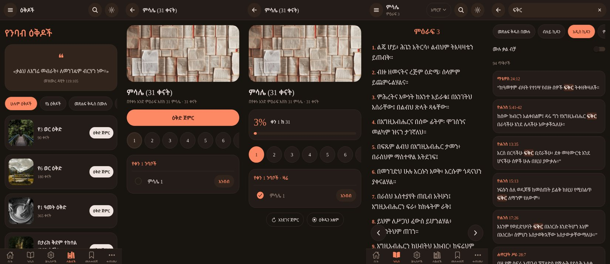

# 11 — Phase 6: search and reading plans

Repository `holy-bible-et`, three commits (dated 23, 27 and 30 Jan 2026).

## Reading plans

The original app's eight plans, in its order and with its photos and wording: 3 months, 6 months, 1 year, chronological, Old + New Testament, the four Gospels, Psalms and Proverbs.

**Problems found in the original plan data** (now checked automatically, and the check fails on the old data):

| Plan | Problem |
|---|---|
| 3 months | Last 2 days empty; 47 chapters read twice (days ended mid-chapter, so the chapter appeared on both days) |
| 6 months | Obadiah never read; an empty day; 18 chapters twice |
| 1 year | Last 3 days empty |
| Old + New Testament | Jeremiah 52 never read; 187 chapters twice; up to 39 chapters on one day |
| Chronological | 17 chapters twice (e.g. Psalm 119 on days 150 and 152) |

**What changed:** the whole-Bible plans are now built from the same idea, with days of about the same number of verses (3 months: 311–375 verses a day). The chronological order and the three short plans are kept as they were, without repeats. Every plan now reads each chapter exactly once, with no empty days.

| Feature | Details |
|---|---|
| Plans tab | Verse card, filters (all, my plans, whole Bible, one month), a card per plan with its length or progress |
| Plan screen | Start; percent done; "day 3 of 31"; days behind; a strip of days (today outlined, finished days filled); tick off each chapter or open it in the reader; tick a whole day; restart or stop (asks first) |
| Saved | In the user database with the start date and ticks; included in backups; old backups still import |

The original app's plan progress can't be carried over, because its days were grouped differently. Reading streaks and the statistics page come in a later phase.

## Search

| Feature | Details |
|---|---|
| Where | Search button in every header; searches the translation being read |
| Scope | Whole Bible, Old Testament, New Testament, or the current book |
| Whole words | Optional; Ethiopic punctuation counts as a word break |
| Results | Up to 500 in Bible order, with matches marked; tap to open the verse |
| Same-sound letters | ሀ ሐ ኀ, ሰ ሠ, አ ዐ, ጸ ፀ find each other in every vowel form, and ሀ = ሃ, አ = ዓ. "ስራ" also finds "ሥራ"; "አመት" finds "ዓመት" (660 verses, against 2 spelled አመት) |
| English | Capitals don't matter |
| Speed | About 30 ms for the whole Bible (target was under 1 s) |

The search hint is in the chosen language (the original app's was English only).

## Checks

| Check | Result |
|---|---|
| Tests | 156 passed; each commit passes on its own |
| Data validation | All translations, daily verses and all 8 plans pass |
| Typecheck, lint | Clean |
| Browser (Pixel 7 size, Addis Ababa time) | Filters; start Proverbs; tick day 1 → 3%; two days later "day 3, 1 day behind"; Read opens Proverbs 3 and closes the plan screen; progress kept after reload; stop. Search: hint in Amharic; ስራ finds ሥራ; ፍቅር in the New Testament 94 verses, whole words 52; tapping opens the verse and closes search; one letter shows the hint. No errors. |

## Needs checking by a native speaker

The Amharic chronological plan name (changed from the original "በዕቃላዊ ተራ" to "በታሪክ ቅደም ተከተል"), the filter names, "days behind", the search wording, and the Oromo versions.

## Next: phase 7

Cross-references, Strong's numbers, parallel reading, verse images, and downloading the other translations.
