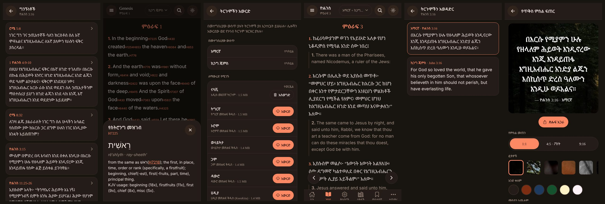

# 12 — Phase 7: cross-references, Strong's numbers, downloads, parallel reading and verse images

Repository `holy-bible-et`, four commits (dated 9, 12, 17 and 21 Feb 2026) and a notes update (23 Feb). All are signed, so GitHub shows them as Verified.

## What's built

| Feature | Details |
|---|---|
| Cross-references | "ግንኙነቶች" in the verse menu: the original app's 343,244 OpenBible.info references, most relevant first, each with its text in the open translation. 10 at first, then "Show more". Tap one to open it. |
| Strong's numbers | A Settings switch (KJV only) shows the number after each word. Tapping one opens the lexicon entry (14,197 entries): Hebrew or Greek word, pronunciation, meaning. Codes inside a meaning link to their own entries. Red letters still work alongside. |
| Translation downloads | A "Download translations" page (from the translation menu and More). There are 16 Bibles: NASV, Tigrigna, Oromo, and the 13 the old app offered (Wolaytta, Gamo, Dawro, Hadiyya, Kambata, Afar, Somali, WEB, ASV, Geneva, Bishops, Coverdale, Arabic). It shows progress, unpacking and saving; each download is checked before it's saved; you can remove or update one. Arabic reads right to left. |
| Parallel reading | From the translation menu: a second Bible under each verse or beside it. Verses stay lined up even where one side combines verses ("14-15"). |
| Compare | "አወዳድር" in the verse menu: the verse in every Bible on the phone. Tap one to switch to it. |
| Verse images | "ምስል" in the verse menu: the verse on one of the old app's 22 photos or a plain colour, in 1:1, 4:5 or 9:16, with dimming, text size, alignment and colour. Share it or save it to Photos. Only permission to *add* photos is asked for. |

**Files are half the old size:** each Bible download is about 1.4–1.6 MB, against 2.8–3.2 MB in the old app (its files carried search indexes the app doesn't use).

## Bugs found in the original data, and fixed

| Bible | Problem | Fix |
|---|---|---|
| Afar | Its 28 books were numbered as Genesis to Hosea. They are really Joshua–Esther and Isaiah–Malachi, so the old app showed Joshua under the name "Genesis". | Renumbered (`data/fixes/afar-books.json`). |
| Dawro | 266 verses numbered in sequence (12, 13…) while the text starts with the real range ("13-14", "15-18"). Verses 13–18 couldn't be reached by number. | The range in the text becomes the label. |
| Gamo | 177 verses the same way ("6-7 …"). | Same. |
| Hadiyya | 227 places where verses are merged without saying so, and 85 verses missing. | The verse before covers the gap; the missing ones are listed. |
| WEB, ASV, Bishops, Kambata | A few verses absent, as in their sources (for example WEB has no Acts 8:37). | Listed as known differences. |
| Daily verse | Some Bibles lack the day's verse (Hadiyya has no Romans 8:1–2; Afar has only some books). | The home screen and reminders show it in Amharic instead. |

Also fixed while building:
- A download that finished still showed "Saving…": a state update merged instead of replacing.
- On the web build, the database storage filled up once Strong's was added. The web keeps only 6 database files. Bundled data now opens in memory there; phones aren't affected.

## Checks

| Check | Result |
|---|---|
| Tests | 252 passed (1 skipped: the Psalm 119 check for Afar, which has no Psalms); each commit passes on its own |
| Data validation | All 18 Bibles, the daily verses, all 8 plans and the download list pass |
| Typecheck, lint | Clean |
| Browser (Pixel 7 size, 36 checks) | Cross-references for John 3:16 open Romans 5:8. Strong's numbers show and the lexicon opens. NASV, Afar and Arabic download and open, and a failed download says so. Afar Genesis says the book is missing, and Joshua reads as Joshua. Arabic is right to left. Removing the open Bible returns to Amharic. Parallel reading works stacked and side by side. Compare switches translation. The image screen's 9:16 card is 9:16. No page errors. Earlier phases' checks still pass. |
| Real phone | Not yet: downloading, and sharing and saving images, need trying on Android |

## To do before downloads work

The download files have to be uploaded once:
1. In `holy-bible-et`, run `npm run data:build && npm run data:downloads`.
2. Upload everything in `build/downloads/` to the R2 storage, in a folder named `app/`. That's 16 files plus `manifest.json`, 23 MB in total.

The old app's files stay where they are. Before release, connect a custom domain to the storage, since `r2.dev` links are rate-limited and meant for testing.

## Needs checking by a native speaker

- Wording not from the old app: "no cross-references", "remove this translation?", "this translation isn't on this phone", "this book isn't in this translation", the Afar description, and the Amharic downloads intro (the old one was garbled).
- Gamo, Dawro and Wolaytta texts have footnote references and some section headings stuck into verses: 3,188, 3,050 and 341 verses respectively. A reader of each language should decide what to remove.

## Licensing

The 13 extra Bibles need the same check as the Ethiopian Bible Society ones:
- WEB, ASV, Geneva, Bishops, Coverdale and the Arabic Van Dyke are public domain.
- Wolaytta, Gamo, Dawro, Hadiyya, Kambata, Afar and Somali aren't known to be.
- The OpenBible.info cross-references need a credit in the app (CC BY).

## Next: phase 8

Home-screen widgets.
