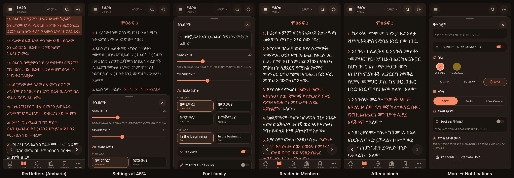

# 13 — Phase 8: reader comfort and fixes

Repository `holy-bible-et`, three commits (dated 5, 8 and 11 Mar 2026) and a notes update (13 Mar). All are signed, so GitHub shows them as Verified.

## What's built

| Item | Details |
|---|---|
| A1. Red letters in Amharic | Jesus' words show in red in the Amharic Bible, from the old app's own list (2,018 verses). The Red letters switch turns them off. |
| A2. More → Notifications | Opens the settings sheet at full height, scrolled to the reminder. More → Backup opens it at the backup section. |
| B1. Live text settings | Moving the font size or line spacing slider changes the Bible text behind the sheet while you drag. The preview verse only shows when the sheet covers the reader (dragged up, or opened from another tab). |
| B2. Smaller settings sheet | Opens at 45% of the screen. Drag the handle or title up to full height, or down to close. Tapping the handle switches between the two. The background dims less. |
| B3. Smaller controls | Buttons, pills, swatches and time chips are about 15–20% smaller. Touch targets stay at least 44 pt. |
| B4. Pinch to zoom | Two fingers change the text size in the reader, in whole points from 14 to 32. It's saved once, when the fingers lift. One finger still scrolls and taps verses. |
| B5. Font picker | "የፊደል አይነት" (Font family), with each choice drawn in its own font. Ge'ez script: Noto Serif (default), Noto Sans, Abyssinica SIL and Menbere. Latin script: the phone's sans or serif font. It applies to the reader, home, compare and cross-references. |
| F2. Keep the screen on | On by default while the Read tab shows, including under the settings sheet. Off on other tabs, or with the new switch. |

**Fonts:** Abyssinica SIL (SIL Global) and Menbere are both under the SIL Open Font License, so they can be bundled; their licences are in `assets/fonts/licenses/`. The old app's list (Arada, Anbassa, Shiromeda, HH Lemd Mono, Nokia PureHeadline) wasn't in its APK and the licences are unknown, so those aren't included.

## Bugs found and fixed

| Problem | Fix |
|---|---|
| 39 of the old app's red-letter entries seemed not to match any verse. | They were keyed by a range label ("Matthew 12:3-4"), not a verse number. Matched by label, all 2,046 segments are found. |
| The More tab's Notifications and Backup rows opened the whole sheet at the top. | They open at their section. |
| On the web, the More → Notifications row led to nothing, because reminders are hidden there. | The reminder card shows, switched off, saying reminders work in the phone app. |
| Leaving the reader just as the screen lock was being taken could leave the screen on for good. Turning off was refused because turning on hadn't finished. | Turning on and off now happen in order. |
| A `Pressable` handle inside the drag area took the drag on the web. | The handle is a plain view with its own tap gesture. |

## Checks

| Check | Result |
|---|---|
| Tests | 276 passed, 1 skipped (Afar has no Psalms). New tests cover red spans and a missing segment failing validation, pinch maths (steps, limits, bad input), sheet snapping, "is the reader showing", fonts per script, and the settings store fields. Each commit passes on its own. |
| Data validation | All 18 Bibles, plus every Amharic red-letter segment being red |
| Typecheck, lint | Clean |
| Browser (Pixel 7 size, 34 checks) | John 3:16 is red, 3:22 isn't, and both are plain with the switch off. The sheet opens at 45%, drags to 92%, back to 45%, and closes. The text behind grows while the slider is being dragged. Notifications scrolls to the reminders. Abyssinica and Menbere show in the preview and the reader, and KJV uses the serif. A pinch takes the text from 20 to 24 and is saved; pinching in stops at 14; a tap still opens the verse menu. The screen lock is held in the reader and under the sheet, and let go with the switch off or on another tab. No page errors. Earlier phases' checks still pass. |
| Real phone | Not yet |

## Needs checking by a native speaker

New wording not from the old app, in Amharic and Oromo:
- "Show all settings" / "Show less" (the sheet's handle)
- "Reminders work in the phone app only."
- "Ge'ez script" / "Latin script"
- "You can also pinch the Bible text with two fingers to resize it."
- "Keep the screen on while reading"

"Font family" is the old app's own wording.

## To try on a phone

- Dragging the sheet, and that sliders inside it don't drag the sheet.
- Pinch to zoom while scrolling: does it fight the scroll?
- The screen staying on while reading, and sleeping on other tabs.

## Next: phase 9

The old app's 8 themes, each in light and dark, and every screen following the theme.
