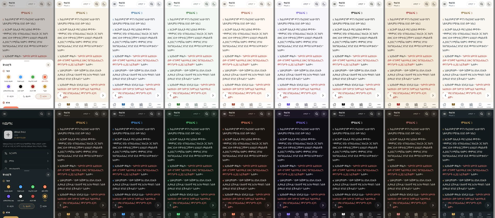
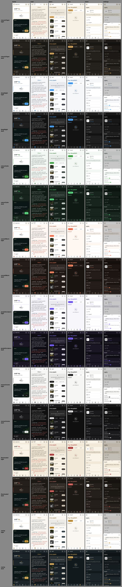

# 14 — Phase 9: themes

Repository `holy-bible-et`, two commits (dated 16 and 18 Mar 2026) and a commit with the browser check and notes (20 Mar). All are signed, so GitHub shows them as Verified.

## What's built

| Item | Details |
|---|---|
| C1. The old app's 8 themes | Classic Paper, Deep Night, Nature Calm, Sunset Warm (still the default), Purple Scripture, Monochrome, Illuminated and Clarity. Each has a light and a dark version, built from the old app's own colours. Light / Dark / System stays a separate choice. |
| Theme picker | Settings → ገጽታ shows the 8 as round swatches in two rows. Each swatch shows that theme's background with its accent inside, in the current light or dark mode, and its name below. The names use the old app's wording in Amharic, English and Oromo. |
| Saved settings | The two earlier themes carry over: "classic" becomes Classic Paper and "sunset" becomes Sunset Warm. |
| A3. Every screen follows the theme | The screens already took their colours from the theme. New: the navigation colours, the background behind screens and under the Android navigation bar (expo-system-ui), and the light/dark mode of alerts, the keyboard and the navigation bar's buttons. These now follow the app's choice, not the phone's. Text fields use the accent for the cursor. |
| Splash screen | Sunset Warm's dark brown instead of Expo's default blue. The saved theme isn't known before the app starts, and the splash icon is white. |

Kept fixed, because they're content rather than theme: verse-image colours, highlight colours, the white text on the verse-of-the-day photo, and the app logo on More.

## Colours changed for contrast

The old app's colours are copied exactly (`src/theme/old-palettes.ts`, checked by a test). Text that doesn't reach WCAG AA (4.5:1) on the background, cards and buttons is darkened (light themes) or lightened (dark themes) just enough. Ten colours needed it, nearly all of them accent-coloured text such as verse numbers, links and selected tabs:

| Theme | Mode | Colour | Old app | Now | Contrast before → after |
|---|---|---|---|---|---|
| Classic Paper | light | accent text | `#d6a75f` | `#7c6137` | 1.75 → 4.62 |
| Deep Night | light | accent text | `#4da6ff` | `#326ca6` | 2.13 → 4.56 |
| Nature Calm | light | secondary text | `#5f7a6e` | `#566f64` | 3.91 → 4.56 |
| Nature Calm | light | accent text | `#4caf50` | `#347736` | 2.33 → 4.58 |
| Sunset Warm | light | secondary text | `#7a6f66` | `#746961` | 4.17 → 4.55 |
| Sunset Warm | light | accent text | `#ff7a59` | `#a8513b` | 2.19 → 4.59 |
| Purple Scripture | light | accent text | `#7b61ff` | `#6952d9` | 3.48 → 4.56 |
| Purple Scripture | dark | accent text | `#7b61ff` | `#917cff` | 3.44 → 4.50 |
| Illuminated | dark | accent text | `#c2504a` | `#d27f7b` | 2.90 → 4.51 |
| Clarity | light | accent text | `#c9973e` | `#856429` | 2.19 → 4.54 |

The accent fills (buttons, selected pills, switches) keep the old app's colours. Text on them is white where that passes, otherwise a near-black of the accent's colour. The old palettes have no colour for round buttons, so one is mixed from the background and the text colour. The red-letter colour passes in every theme.

## Bugs found and fixed

| Problem | Fix |
|---|---|
| The splash screen was still Expo's default blue. | Sunset Warm's brown. |
| Alerts, the keyboard and the Android navigation bar followed the phone's light/dark setting, even when the app was set to the other one. | They follow the app's choice. |
| The Light / Dark / System buttons had no spoken label; a screen reader read the icon glyph and the word together. | Each has its label. |
| The selected Light/Dark button's outline used the accent fill colour, which is faint on light themes (2.2:1 for Sunset Warm). | It uses the accent text colour. |

## Checks

| Check | Result |
|---|---|
| Tests | 314 passed, 1 skipped (Afar has no Psalms). New tests: the old colours match the reference file exactly; every palette has every key; text, muted text, accent text, verse numbers and red letters reach 4.5:1 on the background, cards and buttons in all 16 palettes; only colours that failed were changed; theme names in all three languages; the old saved names carry over. Each commit passes on its own. |
| Data validation, typecheck, lint | Clean |
| Browser (Pixel 7 size, 36 checks) | The 8 themes appear in the old app's order. In each theme, light and dark, the page and the reader have that theme's background, also in dark mode while the browser is light. Choosing System follows the browser again. No page errors. |
| Contact sheet | Home, Read, Plans, Notes, More and Settings in all 16 combinations (below). |
| Real phone | Not yet |

## Needs checking by a native speaker

Nothing new: the theme names are the old app's own wording.

## To try on a phone

- The Android navigation bar and alerts in the app's Light or Dark mode while the phone uses the other.
- The splash colour.

## Next: phase 10

Reading stats (days active, streaks, chapters and books read, milestones) and plan reminders.
