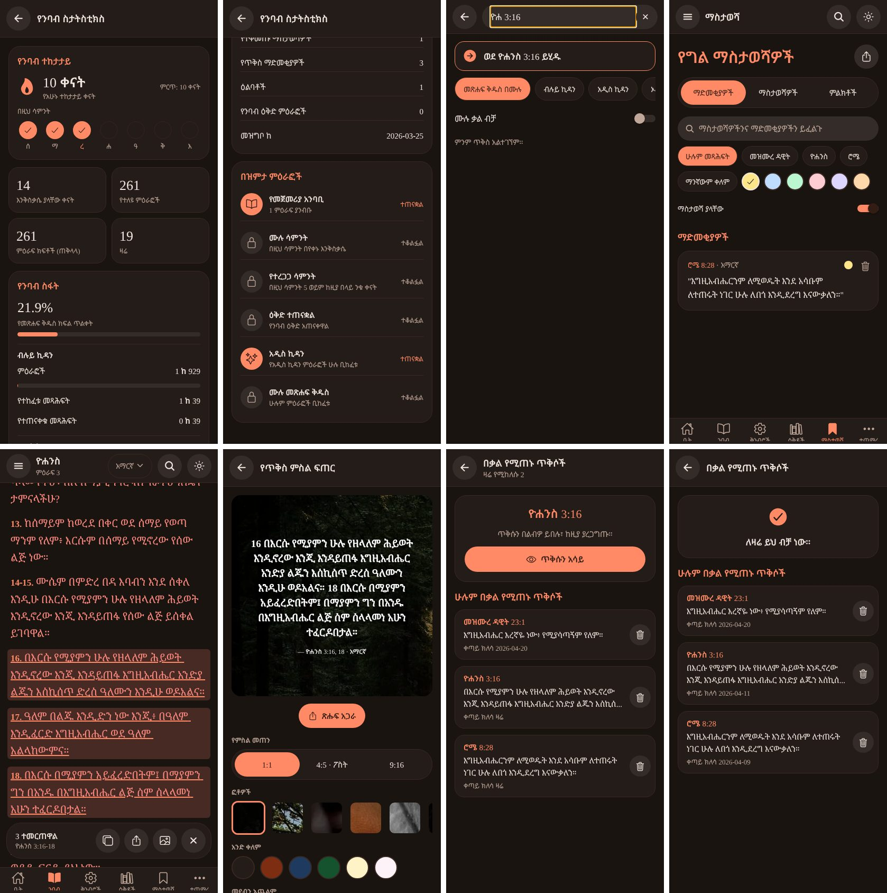

# 15 — Phase 10: reading stats and study tools

Repository `holy-bible-et`, five commits (dated 23 Mar – 7 Apr 2026) and a commit with the browser check and notes (10 Apr). All are signed, so GitHub shows them as Verified. Phase 11 (widgets) was built at the same time in another chat, on its own branch.

## What's built

| Item | Details |
|---|---|
| D1. Reading Stats | From More (`የንባብ ስታትስቲክስ`), as in the old app, with its wording. Current and longest streak, this week as seven days, days active, different chapters, chapter openings, chapters today, how much of the Bible has been opened, and chapters and books opened and finished in each testament. Also notes, highlights, bookmarks and plan ticks. |
| Milestones | The old app's six "Quiet milestones", shown done or locked: First Reader, Full Week, Steady Week (5+ days), Plan Finished, New Testament and Whole Bible Visited. The two week ones count the current week, as the old wording says. |
| How a day counts | A day counts when a chapter was opened that day, in the phone's local time. Each reading now stores its local date, so the stats don't move if the time zone changes later. A streak survives until a whole day is missed. |
| F9. Plan reminder | A new setting chooses what the daily reminder shows: the verse of the day, the reading plan, or both. With a plan under way it says "Day 12 of your plan: Proverbs 12", and a tap opens that day's first chapter. Days outside the plan fall back to the verse. |
| F1. Go to a verse | In search, a reference such as "ዮሐ 3:16", "ዮሐንስ 3", "John 3:16-18", "Jn 3:16", "Yoh 3:16" or "ዮሐንስ ፫፥፲፮" shows a "Go to" result first. It knows every book name in Amharic, English, Oromo and Tigrigna, short forms, book codes and numbered books. It works with or without spaces, with Western or Ethiopic digits, and with letters that sound the same (ሐ/ሀ, ኍ/ሁ…). |
| F4. Find notes and highlights | The Notes tab has a search box: note text, verse text, a book name in any language, or a reference such as "ዮሐ 3". There are filters for book, highlight colour, and "With a note". |
| F5. Export notes | A share button on Notes makes a text file of notes and highlights, grouped by book in Bible order. Each verse has its reference, its text, its colours and its notes. No PDF: a text file opens everywhere. |
| F6. Memory verses | "Memorise" in the verse menu adds a verse; Memory verses (from More) has a daily review. It shows the reference, reveals the text when asked, then "I knew it" or "Again". Correct answers wait 1, 3, 7, 14, then 30 days; "Again" shows it again the same day. |
| F10. Share a passage | A long press in the reader, or "Select verses" in the menu, starts choosing several verses. A bar copies or shares them with one reference ("ዮሐንስ 3:16-18", or "ዮሐንስ 3:16, 18" with a gap), or makes one verse image of them. |
| Schema 3 | One migration for the phase: the reading day on each history row, and a table for memory verses. Backups now include the whole reading history (the screen keeps only the latest 500) and memory verses. Older backups, and the old app's, still import. |

## Bugs found and fixed

| Problem | Fix |
|---|---|
| Backups held only the latest 500 readings, because they reused the list the screen shows. | Backups include the whole history. |
| Verse images of long passages overflowed the card and hid the reference. Several verses made this common. | The text size is worked out from the card's area and the passage's length, measured for Ge'ez letters. |
| After "Again", the same verse came back with its text already showing. | Each answer starts a fresh, hidden card. |
| Search said "No verses found" under a valid "Go to" result. | That line is hidden when a reference was typed. |

## Checks

| Check | Result |
|---|---|
| Tests | 503 passed, 1 skipped. New tests cover streaks across month and year ends, gaps and the stored local day; the milestone rules; the reminder text and which plan it follows; 138 reference cases (every book name in every language, short forms, numbered books, Ethiopic digits, wrong references); the review spacing; the Notes filters and export format; the several-verse references; the schema 3 upgrade from a schema 2 database; and backup round trips, including a backup from before phase 10. Each commit passes on its own. |
| Data validation, typecheck, lint | Clean |
| Browser (Pixel 7 size, 37 checks) | A schema 3 backup restores through Settings. Reading Stats shows the seeded streak, totals and milestones. "ዮሐ 3:16", "Jn 3:16-18" and Ethiopic digits go to the verse. Notes filters by book name, colour and "With a note", and the export file is grouped by book. Three verses are copied with one reference and made into one image. The memory review works with "I knew it" and "Again". No page errors. The checks of phases 6–9 still pass. |
| Real phone | Not yet |

## Needs checking by a native speaker

The stats and milestone wording is the old app's. New wording to check in Amharic and Oromo:
- "Memorise" (በቃል ያጥኑ / Qayyabadhu) and the memory review buttons: "Show verse", "I knew it", "Again", "That's all for today".
- The reminder choice ("What the reminder shows", "Reading plan", "Both") and "Day {n} of your plan: …" (የዕቅድዎ ቀን {n}፦ …).
- The Notes search, filters and export labels, "Go to {reference}", "Select verses" and "{n} selected".
- Should the week in Reading Stats start on Monday (as now) or Sunday?

## To try on a phone

- A long press on a verse starts choosing several (the web has no long press, so only the menu was checked).
- Sharing the notes export file.
- A plan reminder, and tapping it.

## Next

Phase 11 (widgets and a development build) merges into `main` now that phase 10 is there. Then phase 12, animations and polish, which includes the new screens.
