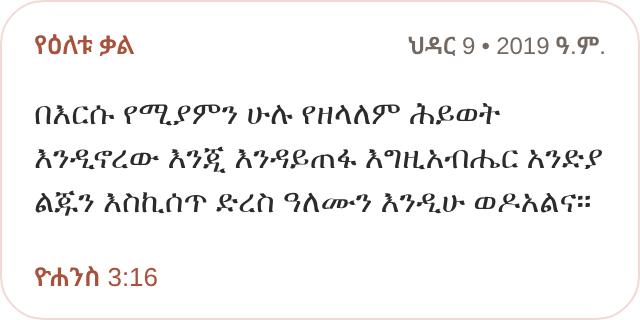

# 16 — Phase 11: home-screen widget and a development build

Repository `holy-bible-et`, branch `phase-11-widgets`: three signed commits, dated 14, 18 and 22 Apr 2026. Phase 10 is being built in another chat at the same time, so this branch merges into `main` once phase 10 is there.

## What's built

| Item | Details |
|---|---|
| Verse-of-the-day widget (Android) | "የዕለቱ ቃል", the Ethiopian date, the verse and its reference. It's the same verse as Home, in the reader's translation, or in Amharic if that translation lacks it. Tapping it opens the verse in the reader (`ethiobible://read?book=&chapter=&verse=`). |
| Follows the app | The app's theme (all 8) and its Light / Dark / System choice; with System it follows the phone. The title and date are in the app's language. Changing the translation, language or theme in the app redraws the widget straight away. |
| Size | It starts at 4×2 cells and can be resized. The text size (15–20) and the number of lines follow its size, so short verses get bigger text and long ones are cut with "…". |
| Stays up to date | Android redraws it every hour, so a new day's verse appears within an hour of midnight even if the app isn't opened. The app also redraws it when it opens or comes back on a new day. |
| Widget list preview | An image of the widget, shown when choosing it from the home screen. |
| Development build | `eas.json` with `development`, `preview` and `production` profiles, and `expo-dev-client`. The build runs in Expo's cloud from the owner's laptop. The steps are in `docs/project-state.md`. |

### Choosing the widget library

| Option | Verdict |
|---|---|
| `expo-widgets` 58 (Expo's own, in SDK 58's list of modules) | Mainly for iOS. Android support is behind an experimental switch, and Android widgets made with it never update on their own: the verse would stay on yesterday's until the app was opened. Kept in mind for the iOS widget later. |
| `react-native-android-widget` 0.26 (MIT, supports Expo SDK 54+) | Chosen. Android starts a small background task that works out the day's verse itself, on a schedule. It has its own config plugin and supports custom fonts and tap links. |

## How it works

- `src/widgets/verse-widget-data.ts` works out what the widget shows; it's pure code, so it's tested.
- `load.ts` loads the saved settings and the verse, also when Android starts the app only to draw the widget.
- `render.tsx` draws it, and `sync.android.ts` redraws it from the app.
- The app now starts at `index.ts`, which loads Expo Router and registers the widget's task.
- The widget can't use the fonts the app loads, so the config plugin copies Noto Serif Ethiopic and Noto Sans Ethiopic into the Android app. Latin and Arabic text uses the phone's font.

## Bugs found and fixed

None in the existing app. During the work:

| Problem | Fix |
|---|---|
| A preview drawn with the Ethiopic fonts alone showed the digits in a serif font, because the Noto Ethiopic fonts have no digits. Android fills them in from its own sans font. | The preview image uses the same fallback, so it matches what the phone shows. |

## Checks

| Check | Result |
|---|---|
| Tests | 334 passed, 1 skipped (Afar has no Psalms). 20 new: the widget's verse is Home's verse of the day and changes at local midnight, not before; its link opens that verse, and a valid chapter for every day of a year; Amharic, English and Oromo wording, the Ethiopian date, the Amharic fallback and Arabic right to left; the text sizes and line counts; the background task with saved settings (translation, language, theme, Dark) and with none; taps and other widgets are ignored; `app.json` names the widget, fonts and preview the code uses. Each commit passes on its own. |
| Data validation, typecheck, lint | Clean |
| Android project generated (`expo prebuild`, in a scratch copy) | The widget's receiver and its hourly update are in the manifest, the size settings and preview are in the widget's description, and the two fonts are copied. |
| Android JS bundle (`expo export -p android`) | Builds, with the widget task included |
| Browser checks of the earlier phases (Pixel 7 size) | All 136 pass with the new entry point: restyle, plans and search, phase 7, phase 8 and phase 9 (quick). No page errors. |
| Compiling the Android app | Not possible here: this environment can't reach Expo's or Google's servers. The owner's EAS build does it. |
| Real phone | Not yet |

## Needs checking by a native speaker

Nothing new: the widget uses the existing "የዕለቱ ቃል" wording and Ethiopian date.

## To try on a phone (a `preview` build)

- The widget: add it, check it matches Home, tap it, resize it, switch theme / Light-Dark / translation / language, and check it changes after midnight.
- Saving a verse image to the gallery (Expo Go can't).
- Reminders and tapping them, also with the app closed.
- The phase 8 and 9 items still waiting for a phone: dragging the settings sheet, pinch to zoom, the screen staying on, the navigation bar colours and the splash.
- The package id is the old app's, so the old app has to be uninstalled first (make a backup in it first; the new app imports it).

## Next

Merge into `main` once phase 10 is pushed, then phase 12: animations and polish.
