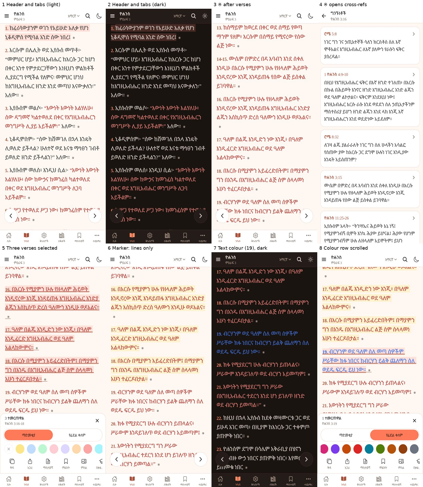
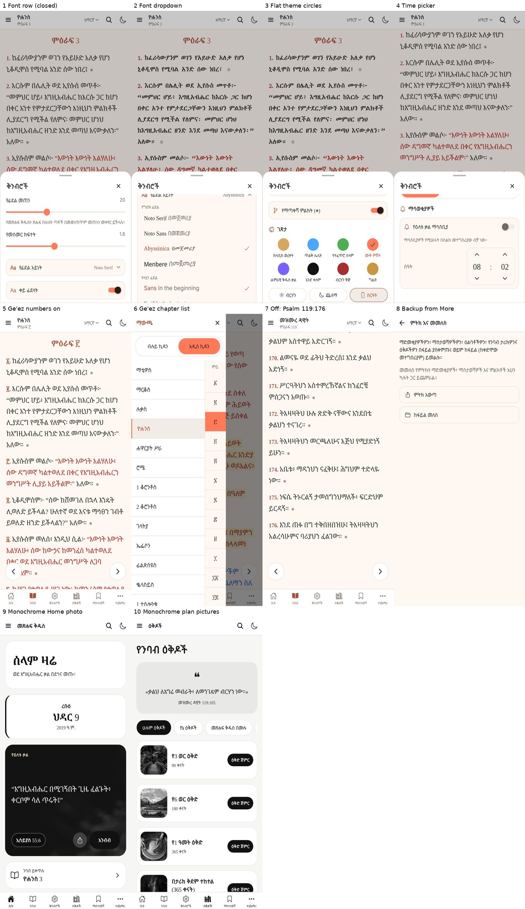

# 17 — Phase 11.5: fixes from the phone test

Repository `holy-bible-et`, branch `main`. First, phase 11 (the widget and development build) was merged into `main` in one signed merge commit dated 24 Apr 2026. Then five signed commits, dated 27 Apr – 9 May 2026, fix nine things the owner found on their Android phone. Another Bible app's screenshot was the reference for sizes and style, not colours.

## What's built

| # | Item | Details |
|---|---|---|
| 1 | Lighter header and tab bar | Header buttons are just the icon now, with no filled circle. The icon is 22 pt in a 40 pt box, and hitSlop keeps the touch target at 44 pt. Headers are 52 pt high with 16 pt titles, on every screen. Tab icons are 21 pt with 10.5 pt labels, and the bar is flat: a hairline on top, no shadow. |
| 2 | ※ after verses with cross-references | A small, muted ※ follows each verse that has cross-references. Tapping it opens that verse's related verses. It's a separate tap target from the verse. A setting hides it (on by default). |
| 3 | Verse "pop" | A tapped verse scales to 1.015 and back in about 150 ms (Reanimated). There's no animation when the phone asks for reduced motion. |
| 4 | One selection mode | A tap or a long press selects a verse and opens the verse menu. The menu is now a panel at the bottom instead of a modal, so tapping more verses adds or removes them while it stays open. It shows "3 ተመርጠዋል" and one reference ("ዮሐንስ 3:16-18"), with a Cancel button; the back button also cancels. Every action applies to all the selected verses: highlight, text colour, clear, copy, share, verse image, note, memorise and bookmark. Cross-references and compare show only when one verse is selected. The phase 10 "Select verses" mode and its bar are gone. |
| 5 | Highlighter | Two modes: "ማድመቂያ" (Highlight) colours behind the text and "የፊደል ቀለም" (Text colour) colours the letters. The highlight sits on the text spans, so it marks only the lines like a marker pen, not a block around the verse. There are 12 colours (the original app's six plus red, light blue, light green, gold, brown and grey) in a row that scrolls sideways. Text colours are adjusted for each theme to read at 4.5:1. A verse reopens in its own mode. |
| 6 | Settings sheet | The font family is one row that opens a list, with each name and a sample drawn in its own font. Theme swatches are plain circles in each theme's accent, with only a checkmark on the chosen one. There's a new Ge'ez numbers toggle. The reminder time picker takes any hour and minute: arrows step it, and holding an arrow repeats. The six older fixed times still load. |
| 6 | Ge'ez numbers | When on, verse and chapter numbers in the reader, the books drawer and plan readings, and Bible references, use Ethiopic numerals. That covers search, Notes, memory verses, cross-references, compare, Home, verse images and copied or shared text: "ዮሐንስ ፫:፲፮-፲፰", Psalm ፻፲፱:፻፸፮. Dates, stats, counts, settings and book names ("1 ቆሮንቶስ") keep 1, 2, 3. |
| 7 | Backup in More | Backup and restore have their own screen, opened from More, and left the settings sheet. |
| 8 | Monochrome photos | The verse-of-the-day photo and the reading plan pictures turn black and white in Monochrome (see below). |
| 9 | The invisible widget | Found and fixed; see "Bugs found and fixed". |

### Notes on a passage, and memorising several verses

Notes are saved one per verse, so the owner was asked what a note on several verses should be. The answer was one note on the passage. It's saved on the first verse and remembers the last, so it shows as "ዮሐንስ 3:16-18" in Notes and in the export, and the note icon appears after each of those verses.

Memorise saves verses next to each other as one passage, and verses with gaps one by one.

### Database: schema 4

- `highlights.style` holds `background` (the default for everything saved before) or `text`.
- `notes.end_verse` holds a passage note's last verse.
- Backups stay version 1 and now carry `style` and `endVerse`. Older backups and databases load as background highlights and one-verse notes. Both are tested.

### Grayscale photos: where it works

React Native 0.88's own `filter` style (`filter: "grayscale(1)"`) is used; expo-image wasn't needed.

| Platform | Support |
|---|---|
| Android | Yes, on every Android version. Grayscale is a colour-matrix filter, which RN applies through a hardware layer (`BaseViewManager`). Only blur and drop shadow need Android 12. Not seen on the phone yet. |
| iOS | Yes, through RN's SwiftUI filter wrapper (`RCTViewComponentView`). Untested; there's no iOS build yet. |
| Web | Yes, as CSS. Checked in the browser. |

## Bugs found and fixed

| Problem | Cause and fix |
|---|---|
| **The home-screen widget showed nothing**, though its outline appeared on a long press. | The React Compiler is on for the whole app. It rewrote the widget component to use a React hook (a memo cache). The widget library calls widget components as plain functions, outside React, so building the widget threw an error every time, from the app and from the background task alike. Until a draw succeeds, the widget's first layout is fully transparent, which is why only the outline showed. A `"use no memo"` line keeps the component a plain function. The background task also now draws a simple widget (title, date and reference in the default theme) if loading anything fails, so it can never be blank. |
| On the web, radio buttons (theme, highlight mode, colours) didn't say which one was chosen. | react-native-web ignores `accessibilityState` on `Pressable`. They now use `aria-checked`/`aria-selected`, which work on phones too. |

## Checks

| Check | Result |
|---|---|
| Tests | 585 passed, 1 skipped (Afar has no Psalms): 62 new since the merge of phases 10 and 11 (523 passed). They cover:  • **Widget:** compiled with the React Compiler exactly as Metro does. Without the fix it gets a hook, with it none. The library's own layout builder runs on the result, and the background is opaque and themed in light and dark. The fallback widget draws when loading fails.  • **Ge'ez numbers:** 1–176 (all different, Ethiopic digits only, and read back by the existing reference parser), 119 → ፻፲፱, 200, 1000, 10,000, ranges, and copied text.  • **Highlighter:** all 12 text colours reach 4.5:1 in all 16 palettes.  • **Data:** the schema 4 upgrade, saving styles and passage notes, new and old backups, a broken end verse, and passage notes on each verse.  • **Settings:** the time picker reaches all 1,440 minutes and wraps round, any "HH:MM" is accepted and broken ones dropped.  • **The new verse menu.**  Each commit passes on its own. |
| `npm run check`, `expo lint` | Clean |
| Browser check `e2e/phase11-5.js` (Pixel 7, light; highlighter also in dark) | 38 pass: header buttons 40 pt with no fill and a 22–24 pt icon, the tab bar 48 pt; ※ opens cross-references without opening the menu; three verses selected and highlighted, copied as one passage, one removed ("3:16, 18"), Cancel; the marker colour on the text spans, not the verse; text colour in blue with no background; the colour row scrolls (570 > 386 px); the font dropdown, each name in its own font; swatches with no border; Ge'ez numbers on (reader, references, books drawer, Psalm ፻፲፱:፻፸፮) and off, counts staying 1, 2, 3; the time picker 07:00 → 08:02; Backup on its own screen and not in the sheet; Monochrome grey on Home and Plans, colour again in other themes. No page errors. |
| Browser checks of earlier phases | All pass: restyle and plans/search, phase 7 (36), phase 8 (34), phase 9 (all 8 themes, light and dark), phase 10 (updated for the new verse menu and font dropdown). |
| Merge of phase 11 | Conflicts in `plan.md`, `project-state.md` and `_layout.tsx`, all kept from both sides. Checks, lint, and the phase 9 and 10 browser checks passed before it was committed. |
| Real phone | Not yet; see below. |

## Needs checking by a native speaker

- New wording in am and om: "የግዕዝ ቁጥሮች" (Ge'ez numbers) and its hint, "የማጣቀሻ ምልክት (※)", "የቁጥር {n} ማጣቀሻዎች", "ሰዓት / ደቂቃ" with "ጨምር / ቀንስ", "ማድመቂያ" (Highlight) and "የፊደል ቀለም" (Text colour), "ምርጫውን ሰርዝ" (Cancel selection), and the backup screen's intro.
- The new colour names: ቀይ, ፈዛዛ ሰማያዊ, ፈዛዛ አረንጓዴ, ወርቃማ, ቡናማ, ግራጫ. In Oromo: Diimaa, Cuquliisa ifaa, Magariisa ifaa, Warqee, Magaala, Daalacha. Oromo already uses "Diimaa laafaa" for pink, close to "Diimaa" for red.
- Ge'ez numerals from 1,000 up (the app writes ፲፻). Bible numbers stop at 176, so the app never shows them.

## To test on the phone

**The widget first.** The fix is in JavaScript only; no native code changed in this phase.

1. On the laptop, in the repo: `git pull`, then `npm ci`.
2. Build a `preview` APK, which has the JavaScript inside: `npx eas-cli@latest build --profile preview --platform android`. It takes about 15–20 minutes and ends with a link and a QR code.
3. On the phone, open the link, download the APK and install it over the earlier build. Then remove the old widget from the home screen and add it again: long-press the home screen → Widgets → Holy Bible → "የዕለቱ ቃል".
4. What to look for:
   - A rounded card in the app's theme, with the title "የዕለቱ ቃል" and the Ethiopian date at the top, the verse in the middle, and its reference at the bottom. It's the same verse as Home's.
   - Switch Light/Dark in the app: the card follows.
   - A tap opens the verse in the reader.

The **development build** you already have doesn't need rebuilding for this fix, but it loads its JavaScript from the laptop: run `npx expo start --tunnel ngrok --clear` and open the app from it, and the widget should draw. With the laptop off, the development build's widget can stay empty. That's expected, and is why `preview` is the build for testing the widget.

Then:
- Tap a verse, then tap two more: all three should be selected while the menu stays open. Long-press too. Scroll while the menu is open. Back should cancel.
- Both highlight modes on a few verses; check the text colours in a dark theme and in Monochrome.
- The ※ mark: is it easy to hit without catching the verse, and is it too small or too faint?
- The pop: is it noticeable but calm? Turn on "Remove animations" in Android's accessibility settings: it should stop.
- The time picker: hold an arrow to step quickly, then check a reminder arrives at that time.
- Monochrome: Home's photo and the plan pictures in black and white.
- The header and tab bar sizes against the other app.
- From phase 11: saving a verse image to the gallery, and reminders with the app closed.

## What's next

Phase 12: animations and polish (the onboarding tour and an accessibility pass). The new verse menu panel should slide in, and the native-speaker list above can be settled there.
