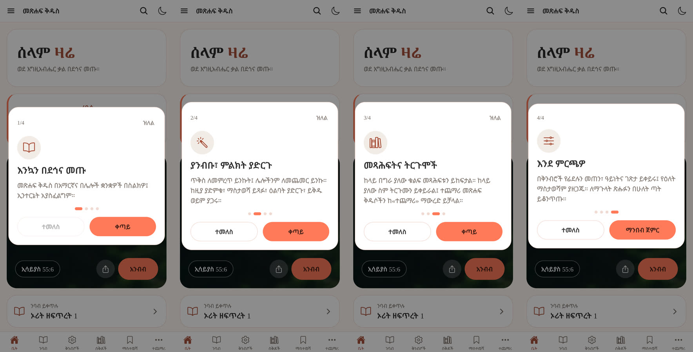
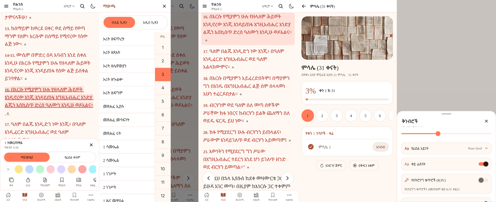

# 18 — Phase 12: animations and polish

Repository `holy-bible-et`, branch `main`. Four signed commits dated 12–22 May 2026: the animations, a short welcome tour, an accessibility pass, then the browser check, a wording checklist and notes.

## What's built

| Item | Details |
|---|---|
| One pace for all motion | `src/motion` holds every duration: a press 90 ms, the verse pop 70 + 80 ms, small changes 180 ms, panels and bars 220 ms, and 250 ms at most. There's one easing that starts fast and settles with no bounce. Every animation follows the phone's "reduce motion" setting. A test fails if code elsewhere animates without these timings, springs, or scrolls with animation. |
| Verse menu panel | Slides up from the bottom when the first verse is chosen, and back down when the selection ends. |
| Menus and drawers | The books drawer slides in from the left. The translation dropdown fades in and grows slightly. |
| Verse pop | Unchanged in feel (1.015, about 150 ms), now on the shared timings and easing. |
| Buttons | Dip to 94% while pressed: header icons, the verse menu's actions, the chapter arrows, Downloads, Memory verses and the tour. |
| Pills | The selected colour slides to the chosen option (Old / New Testament, Highlights / Notes / Bookmarks, Highlight / Text colour…). |
| Progress bars | Fill instead of jumping: reading plans, a plan's page, Reading Stats, downloads. |
| Chapters | A new chapter fades in. A verse opened from a link (search, a note, the widget, a reminder) is highlighted, and the highlight fades out instead of vanishing. |
| Lists | Rows in Notes and Memory verses fade in and out, and the rest close the gap. Downloads' rows fade between "Download", the progress bar and "Remove". |
| Reduce motion | Everything above jumps straight to its end. Screens and overlays open without sliding or fading, and a link jumps to its verse instead of scrolling. |
| Welcome tour | Four cards in am, en and om over the screen behind, like the original app's tour (which had nine steps, all but the first empty and in English): welcome, reading and marking verses, books and translations, settings. Skip, Back, Next and "Start reading", with dots and "1/4" (read out as "Step 1 of 4"). It opens once, the first time Home shows, and More → Welcome tour shows it again. |
| Switches | In Settings, Search and the Notes filter, the label and switch are one control: tapping anywhere on the row toggles it, and a screen reader reads one switch with its name and state instead of two stops. |
| Screen-reader focus | The books drawer, translation dropdown, settings sheet, Strong's and parallel sheets and the tour keep the screen reader inside them, and its "escape" gesture closes them. |
| Text size | The phone's text size applies everywhere; only the books drawer's fixed-height rows stop growing at 1.6×. |
| Wording checklist | `docs/wording-review.md` lists every Amharic and Oromo string waiting for a native speaker (117), with the current English, Amharic and Oromo side by side and a column for corrections, plus 8 open questions. The owner chose to keep the current wording until it's reviewed. |

## Bugs found and fixed

| Problem | Cause and fix |
|---|---|
| On the web, the tour card didn't grow when a card with longer text appeared; the buttons spilled past its edge. | Reanimated's web build fixes a view's size and position after its entering animation, inside a transparent modal. A small `FadeIn` component, driven by an animated value, now fades in views whose content can change: the tour, the translation dropdown, a new chapter and the download rows. |
| The tour didn't open in the app's tests when they ran one after another. | Home used the app-wide `router`, which isn't connected until a navigator has drawn. It now uses the screen's own router and waits for the navigator. |
| Saving the tour as seen crashed in tests ("destroy is not a function"). | The effect returned the settings store's promise, which React took as a clean-up function. It now returns nothing. |
| The browser checks of earlier phases couldn't skip the tour by seeding `localStorage`. | On the web the app's settings live in expo-sqlite's storage, not `localStorage`. A helper (`e2e/skip-tour.js`) opens Home first and presses Skip, which the app remembers. |

## Checks

| Check | Result |
|---|---|
| Tests | 604 passed, 1 skipped (Afar has no Psalms): 19 new. They cover the motion rules (every duration 250 ms or less, reduce motion, no animation outside `src/motion`), the tour (opens once, steps, skip, More), switch rows, icon button targets, pills, progress bars, modal overlays, and the tour's colours at 4.5:1 in all 16 palettes. Each commit passes on its own. |
| `npm run check`, `expo lint` | Clean |
| Browser check `e2e/phase12.js` (Pixel 7) | 30 pass. Motion is measured by sampling positions a few milliseconds apart: the verse menu rises from y 1040 to 582 and goes back down; the drawer slides from x −365 to 16; the pill slides 148 → 37 → 18; a new chapter is at 39% opacity 50 ms in; the link highlight steps down to 0; the plan bar fills 0 → 4 → 10 px. With reduce motion on, the menu and drawer appear in place at once. The tour opens once, steps, goes back, finishes, stays closed after a reload, and reopens from More. All 397 controls on 21 screens have a spoken name; a settings switch is the whole 46 pt row. No page errors. |
| Browser checks of earlier phases | All pass: restyle and plans/search, phases 7, 8, 9 (quick), 10 and 11.5. |
| On the phone | Not yet: see below. |

## Needs native-speaker review

- Everything in `docs/wording-review.md`. The new phase 12 strings are at the top: the tour's titles and text, "የመግቢያ ጉብኝት" (Welcome tour), ዝለል / ተመለስ / ቀጣይ / ማንበብ ጀምር, and Oromo "Daawwannaa seensaa", Darbi, Duubatti, Itti aanu (the old app's word for Next), Dubbisuu jalqabi.

## Not yet tested on a phone

- How the animations feel on Android, and with "Remove animations" turned on.
- The tour on a fresh install.
- TalkBack on the switch rows, the drawer and the sheets; large system text.

## What's next

Phase 13, the release: licences (the Bible Society of Ethiopia's translations, the extra Bibles, OpenBible.info credit), a privacy policy, a custom domain for downloads, store listings in am, en and om, a production EAS build tested on the owner's phone, and the Play Console.
