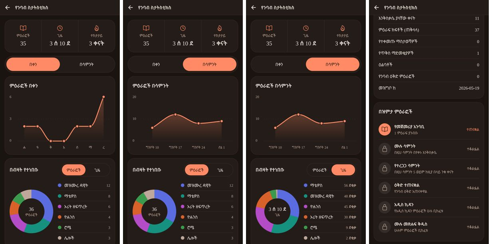
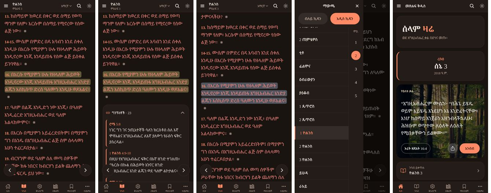
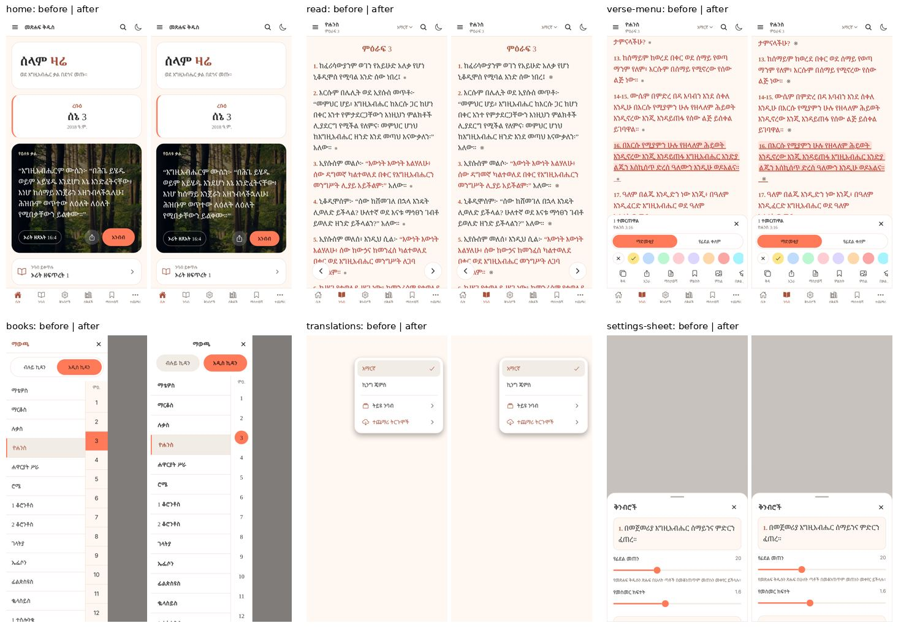
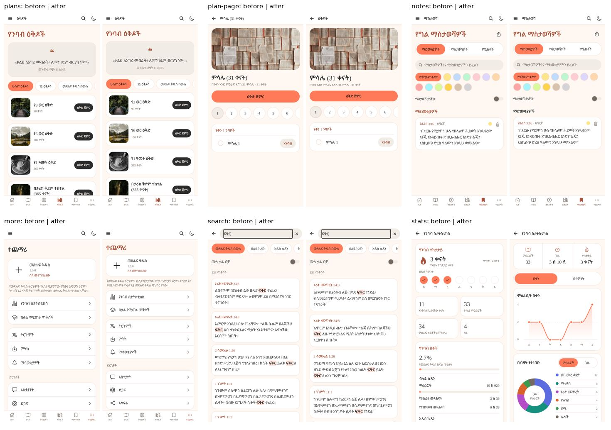
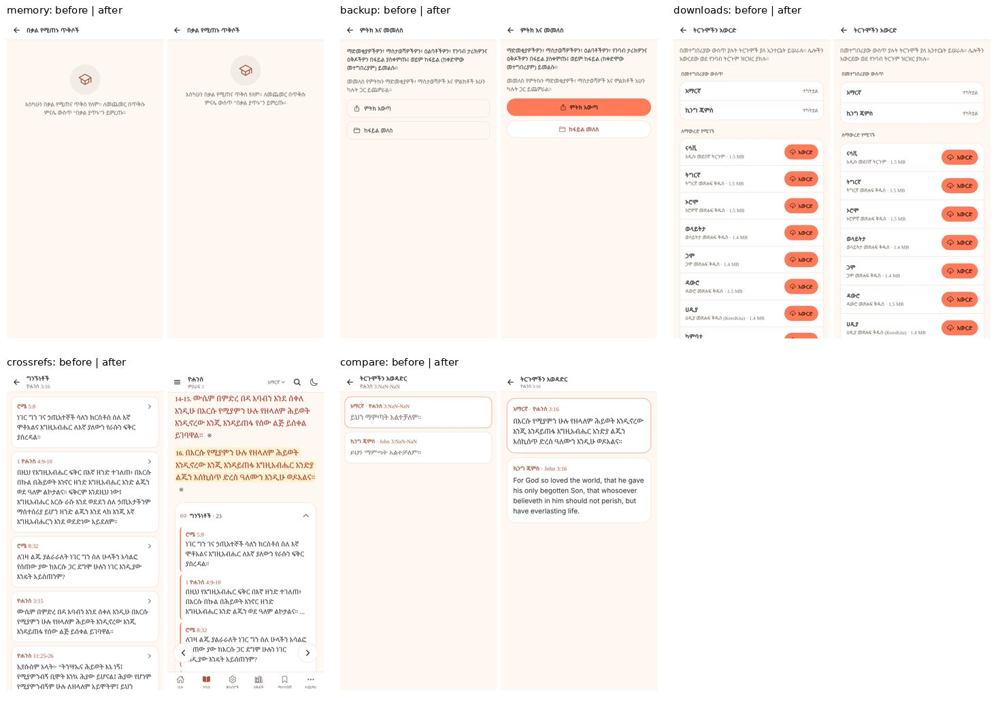
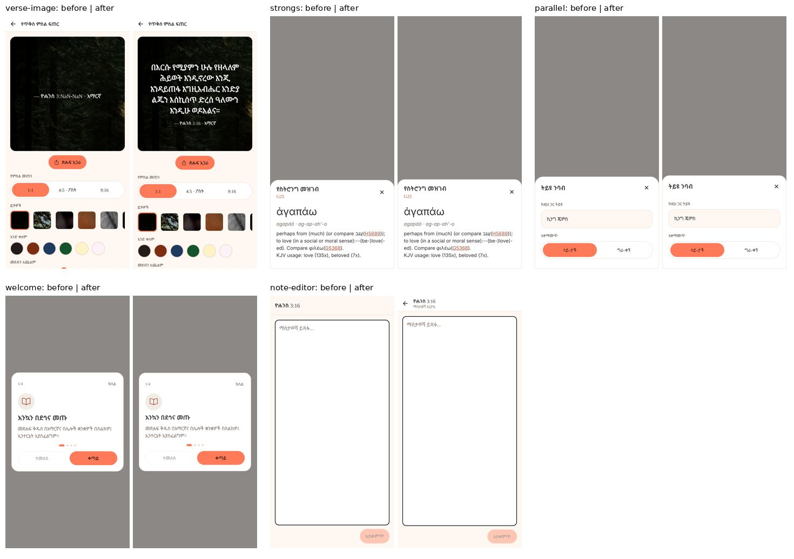

# 19 — Phase 12.5: fixes from the phase 12 phone test, consistency and polish

Repository `holy-bible-et`, branch `main`. Ten signed commits dated 25 May – 12 Jun 2026: the plan, then the reader, reading time, Reading Stats, Home and the books drawer, the consistency pass, rounded highlights, and the browser check and notes. The owner tested the phase 12 build on their phone and sent two other Bible apps' screenshots, a Reading Stats page and a books drawer, as the reference for layout and style (not colours).

## What's built

| Item | Details |
|---|---|
| ※ at the text's size (12.5-1) | The cross-reference mark after a verse was three-quarters of the text size; it now matches the verse text at every font size. |
| Cross-references under the verse (12.5-2) | ※, or "Cross-references" in the verse menu, opens a panel under that verse that expands and collapses in place (220 ms, or at once with reduce motion). It shows the count, each reference with the start of its text, and "Show more"; tapping one opens that verse. One is open at a time and a new chapter closes it. The separate cross-references page is gone (the owner agreed; nothing else linked to it). |
| Rounded highlights (12.5-3) | Android draws a highlight behind text as a plain rectangle and can't round it. The owner saw three options (a rounded marker on each line, one rounded block per verse, or square on Android) and chose the first. On phones the app draws a rounded shape behind each line from where the text was laid out, the letters' height so the line spacing still shows; the web rounds one span per line with CSS. The text wraps exactly as before. |
| Reading time (12.5-5) | New. Time counts while the Read tab shows a chapter with nothing over it and the app is open, and stops 5 minutes after the last touch or scroll (the owner's choice: Amharic chapters are long, and a slow reader may not touch the screen for minutes). It's saved every 30 seconds per chapter visit, at most an hour each. The database gains one column (schema 5); backups stay version 1, carry the seconds, and older backups still import. Reading from before this version counts for chapters and streaks but not time, and the page says time is counted from now on. |
| Reading Stats (12.5-4, 12.5-6) | Three tiles (chapters, time, streak), a Daily / Weekly switch, a line chart of different chapters per day (7 days) or week (4 weeks, labelled with the Ethiopian date of each Monday), and a "Most read" donut of the top five books and "Other", by chapters or by time. The charts grow in and move between views over 250 ms. Below: this week, how much has been read, other counts and the six milestones. Screen readers hear each chart as a sentence ("Chapters per week: Ginbot 10 6, …"). Drawn with react-native-svg (in Expo Go already); chart libraries needed Skia or extra modules. |
| Home's verse buttons (12.5-7) | The reference, share and Read buttons on the verse of the day are all 44 pt, and grow together with large text. |
| Books drawer (12.5-8) | Like the reference: a centred ማውጫ title, two large separate testament pills (the other muted; the colour still slides), book names in 58 pt rows with separators, and chapter numbers in a narrow column behind a vertical line, the current one in a round accent mark (Ge'ez numerals when that's on). It still opens at the current book and chapter. |
| Design tokens (12.5-9) | One type scale, spacing, radii, borders, icon and control sizes in `src/theme/tokens.ts`, taken from what the app mostly used. Scripture text isn't included: it follows the reader's settings. A test fails on a size off the scales unless the code says why (21 such notes: the greeting, the photo verse, the Strong's word, phase 11.5's compact settings and verse menu, and similar). |
| Audit (12.5-10) | All 22 screens and overlays, with 12 findings written into the plan before anything was fixed: copied headers, a different header on the note editor, two title sizes, three hand-made sheet headers, six heading styles, cards from 16 to 24 pt, buttons of several shapes, four kinds of empty state, mixed icon sizes and padding, and a bug (below). |
| Shared components (12.5-11 – 12.5-13) | Screens moved onto one header (every full page, including search and the note editor), one sheet header, one large title, two heading levels, one card, one list row, primary and secondary buttons, and one loading and empty state. Backup's "make a backup" is now the primary action and "restore" the secondary one; the note's Delete is a red secondary button. |
| Motion (12.5-14) | New motion only where a change was abrupt: the cross-reference panel and the charts, both through the shared timings. Every shared button now dips when pressed, so six screens gained the press feedback the rest had. |

## Changes per screen

| Screen | Change |
|---|---|
| Home | Even verse buttons; recent chapters in a card of list rows like More; the shared card shape. |
| Read | ※ at the text's size; cross-references open under the verse; rounded highlight ends; shared loading, error and "not downloaded" states. |
| Books drawer | Restyled after the reference (above). |
| Settings, Strong's, parallel | One sheet header; the sheets share one top radius (Strong's and parallel were rounder); parallel's labels and "off" button are the shared ones. |
| Plans, Notes, More | One large title style (28 pt; it was 30 or 26); shared cards, headings, empty states and rows. |
| Plan page | The header says "Plans", so the plan's name shows once, as the page title; shared buttons and cards. |
| Search, Compare, Downloads, Verse image | The shared header instead of copies; shared cards, labels and buttons. |
| Stats | Redesigned (above). |
| Memory verses, Backup | Shared buttons, cards, heading and empty state. |
| Note editor | The same header as every other page (it used the navigator's own, with no way back on the web); shared buttons and a proper "verse not found" state. |
| Verse menu, translation dropdown, welcome tour | Left as they were: they already looked intentional (the menu and settings sizes come from the owner's reference). |

## Bugs found and fixed

| Problem | Cause and fix |
|---|---|
| Compare and Verse image showed "John 3:NaN-NaN" when opened with `?verse=16` (the form reader links use). | They only read `start` and `end`. Both now accept `verse` too. Found by the audit's screenshots. |
| The note editor had another header from the rest, and on the web no way back. | It was the only screen using the navigator's built-in header. It uses the shared header now. |
| The phase 12 check of the drawer's sliding pill failed after the restyle. | The separate pills draw a muted shape under each pill before the sliding one, and the check measured the first shape. It measures the slider now. |
| A test of the old schema failed once schema 5 existed. | Its roll-back to schema 3 didn't drop the new column. Fixed in the test. |
| The new browser check's highlight step found no colour. | John 3:16 is yellow in the seeded backup, and choosing yellow again clears it. The check picks blue. |

## Checks

| Check | Result |
|---|---|
| Tests | 634 passed, 1 skipped (Afar has no Psalms): 30 new. They cover the reading-time clock (counting, background, the 5-minute cut-off, idle time counted up to it), schema 5 and backups with and without times, the chart maths (days, Monday weeks across a month end, top books and "Other", time, a smooth line that never dips below its points, ring segments), the cross-reference panel, the ※ size, the rounded markers, and the tokens rules. Each commit passes on its own. |
| `npm run check`, `expo lint` | Clean |
| Browser check `e2e/phase12-5.js` (Pixel 7) | 26 pass. The ※ is 20 px like its verse; opening the panel moves the next verse down in steps (462 → 575 → 993 → … → 1783) and closing puts it back; a reference opens Romans 5:8. The line chart moves between Daily and Weekly through 8 different frames; Most read lists Psalms 12 and Matthew 8 by chapters and Matthew 56 min by time from the seeded backup. Home's buttons are 44 / 44 / 44 pt. The drawer's title is centred, the pills are 50 pt and 12 pt apart, rows 58 pt, the chapter column 63 px with a line. The highlight has 6 px rounded ends with `clone`. All 534 controls on 22 screens have a spoken name. No page errors. |
| Browser checks of earlier phases | All pass: restyle and plans/search, phases 7, 8, 9 (quick), 10, 11.5 (38) and 12 (30), with the cross-reference steps moved to the panel. |
| On the phone | Not yet: see below. |

## Needs native-speaker review

- The 12 new strings, at the top of `docs/wording-review.md`: ጊዜ, ተከታታይ, በቀን / በሳምንት, ምዕራፎች በቀን / በሳምንት, በብዛት የተነበቡ, ሌሎች, the time note, and Oromo Yeroo, Walitti aanu, Guyyaatti / Torbanitti, Kan baay'ee dubbifame.
- A new question: the tile's short hours and minutes, "{h} ሰ {m} ደ" and "{h} sa {m} daq". Are these understood, or is there a usual short form?

## Left over

- Three chip rows (Notes' filters, Plans' filters, Search's scopes) look alike but are separate code; a shared chip needs both one-choice and several-choice behaviour.
- List rows show a press by colouring the row rather than shrinking it, as More's rows did.
- "Tracking since" on Reading Stats still shows a plain date (2026-05-19); an Ethiopian date there is a wording question.

## Not yet tested on a phone

- The rounded highlight markers on Android: do they line up with each line, in Amharic and Latin, at small and large sizes, and after pinch to zoom?
- The cross-reference panel opening under a verse, and tapping its references.
- Reading time: read for a few minutes, leave the phone untouched past 5 minutes, switch apps, then look at Reading Stats.
- The charts drawing and switching, also with "Remove animations" on.
- The books drawer's new layout, Home's buttons, and upgrading from a phase 12 build with existing history (the schema 5 migration).

## What's next

Phase 13, the release: licences (the Bible Society of Ethiopia's translations, the extra Bibles, OpenBible.info credit), a privacy policy, a custom domain for downloads, store listings in am, en and om, a production EAS build tested on the owner's phone, and the Play Console.
